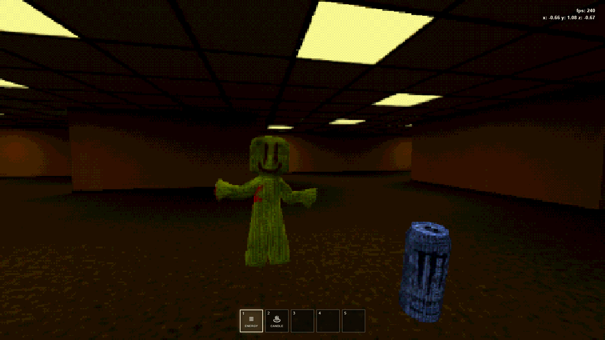

# The Quiet Hour

Атмосферная 3D-прогулка от первого лица в стиле PS1. Низкое разрешение, дрожание вершин, дизеринг, тишина и гул. Геймплея нет — только находиться в месте.



## Стек

- **Three.js** `0.187` — рендер, сцена, постобработка
- **TypeScript** `7.0` — строгие типы
- **Vite** `8.3` — сборка, dev-сервер
- **Web Audio API** — плейлист с автопереходом, шаги, гул ламп
- **Gamepad API** — поддержка DualShock PS1/PS3 через USB-переходник

##  Играть
---> **[Запустить The Quiet Hour в браузере](https://awxke.github.io/thequiethour/)**

*(Для игры нужен браузер с поддержкой WebGL. Наушники рекомендуются).*

## Запуск

```bash
npm install
npm run dev
